<h1 align="center">Orbit</h1>

<p align="center"><b>A fast, animated radial menu for Windows Explorer.</b><br>
Right-click any file, folder or empty space to convert, resize, compress, share to your phone and more,<br>
all from one tiny exe. No installer, ~6 MB of RAM when idle.</p>

<p align="center">
  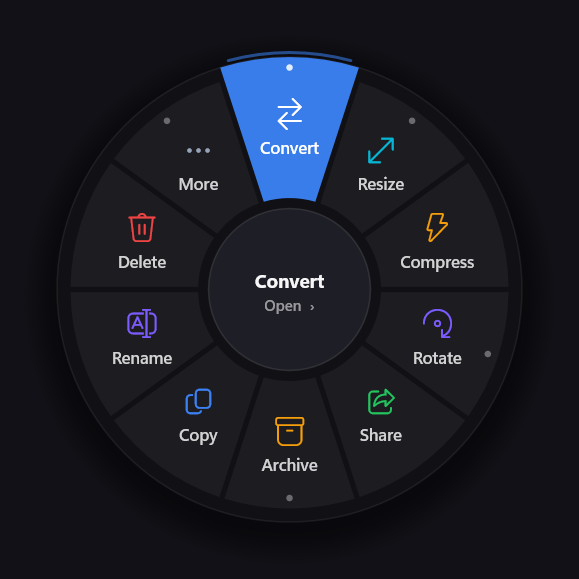
  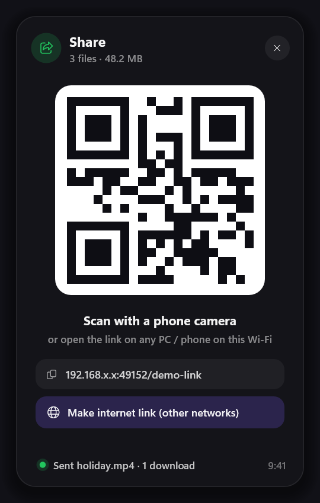
</p>

---

## Highlights

- **Radial menu that adapts to what you clicked.** Images, videos, audio, PDFs, Office files, archives, code, folders and empty space each get their own options.
- **Converts everything.** Images, audio, video and documents, with live progress rings over your files.
- **Share by QR code.** Any phone or PC opens the link in a browser, with no app needed. Optional internet link for other networks.
- **Receive from your phone.** Phones can send files straight into a folder on your PC.
- **Everyday file actions.** Copy, cut, paste, rename, delete to the Recycle Bin, and move/copy to recent folders.
- **Lightweight.** Written in Rust with Direct2D. A single ~2 MB exe that starts instantly and idles at ~6 MB of RAM.
- **Self-installing tools.** FFmpeg, 7-Zip and LibreOffice download automatically the first time a feature needs them.

## Getting started

1. Download `Orbit.exe` from the [Releases](../../releases) page and run it. It lives in the system tray.
2. Press **Ctrl+Alt+Space** (or click the tray icon) to turn the radial menu on or off.
3. Right-click files, folders or empty space in **File Explorer** or on the **Desktop**.

| Control | Action |
|---|---|
| Click a wedge | Run it, or open its submenu |
| Mouse wheel / arrow keys | Next page when there are more options |
| Right-click / Esc / center | Back, or close |
| `1`–`9` | Pick a wedge |
| `Ctrl+C` `Ctrl+X` `Ctrl+V` `F2` `Del` | Copy, cut, paste, rename, delete while the menu is open |
| **Shift + right-click** | The normal Windows menu |

Orbit starts with Windows by default (toggle it in the tray menu). The shortcut can be changed from the tray too.

## Features

### Images

<p>
  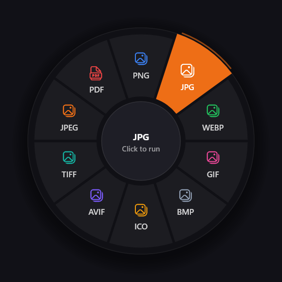
  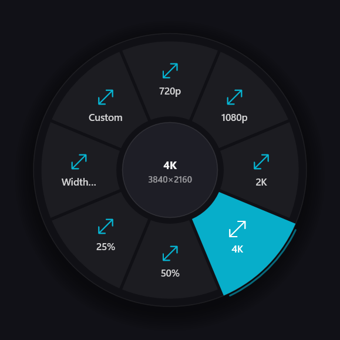
</p>

| | |
|---|---|
| **Convert** | PNG, JPG, JPEG, WEBP, GIF, BMP, ICO, AVIF, TIFF, PDF (transparent images get a white background in JPG) |
| **Resize** | 720p, 1080p, 2K, 4K, 50%, 25%, a set width, or exact width × height |
| **Compress** | Smaller files with the same look (JPEG quality, PNG palette, WEBP) |
| **Rotate** | Right, left, 180°, flip horizontal/vertical |
| **Combine** | Several images into a grid collage, side by side, or stacked |
| **Image info** | Size, megapixels, camera, date, lens settings and GPS, copied with a map link |
| **More** | Strip EXIF/GPS, favicon set (16 → 512 px + .ico), copy as Base64 data URI, images → one PDF |

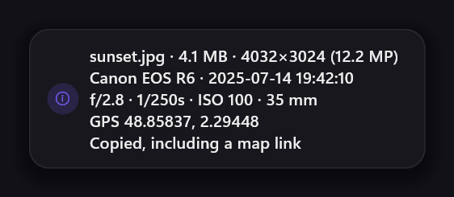

### Video and audio

<p>
  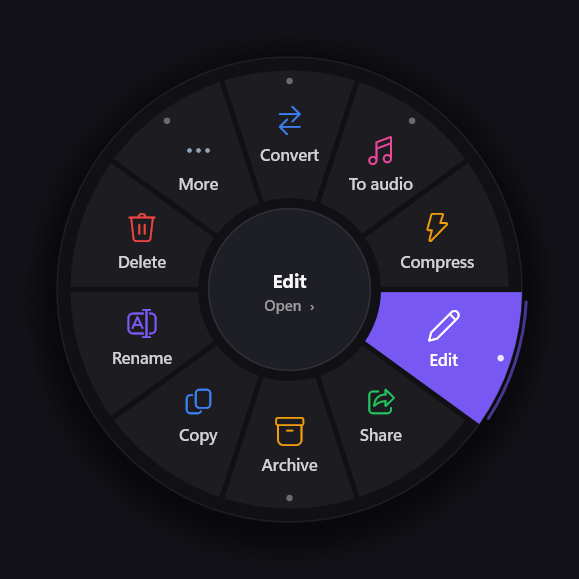
  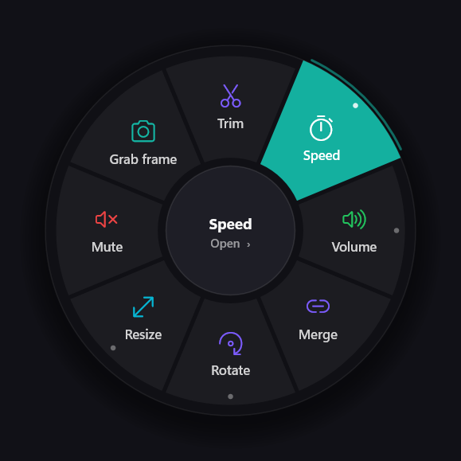
</p>

| | |
|---|---|
| **Convert video** | MP4, MKV, WEBM, AVI, MOV, GIF (palette-optimised) |
| **To audio** | MP3, WAV, M4A, FLAC, OGG |
| **Convert audio** | MP3 128/192/320k, WAV, FLAC, M4A, OGG, OPUS, AAC |
| **Compress** | H.264, much smaller files |
| **Edit** | Trim, speed 0.5×–2×, volume (presets or custom), normalize loudness, merge clips, rotate, resize, mute, grab a frame |

### PDF and Office documents

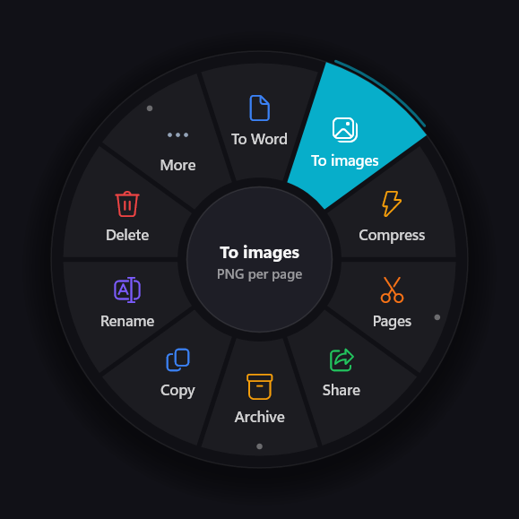

| | |
|---|---|
| **PDF** | To Word, to images (PNG per page), compress, rotate pages, split pages, merge PDFs |
| **Word** | To PDF, DOCX, TXT, HTML, ODT, RTF |
| **PowerPoint** | To PDF, to images, to PPTX |
| **Excel** | To PDF, CSV, XLSX |

Office conversions use Microsoft Office when it's installed, otherwise LibreOffice. PDF → images uses the PDF engine built into Windows.

### Folders and empty space

<p>
  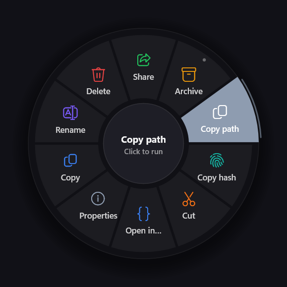
  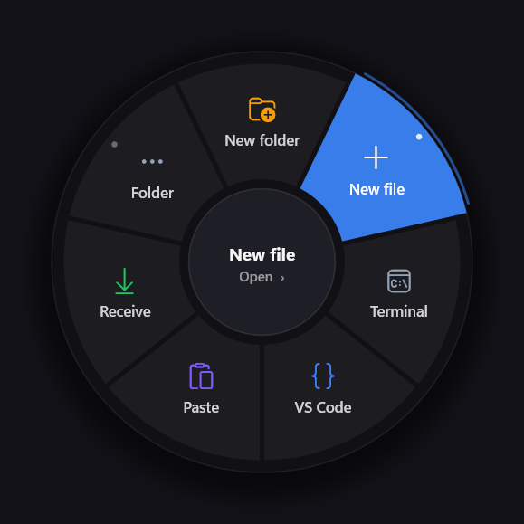
  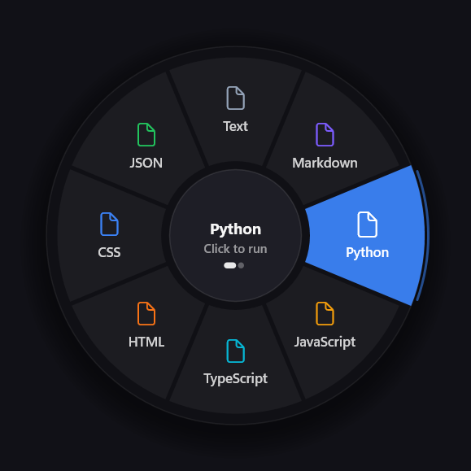
</p>

| | |
|---|---|
| **Folders** | Share, compress, open terminal, open in VS Code, folder size, organize by type or date, flatten subfolders, extract all archives |
| **Empty space** | New folder, new file (16 templates: Python, HTML, JSON, .gitignore…), terminal, VS Code, paste (files, text or images), receive from phone, show/hide hidden files |
| **Archives** | Extract here, extract to folder (ZIP, RAR, 7z, TAR, GZ…) |
| **Code / text** | Open in VS Code, format JSON, count lines, Base64 |

### On every file and folder

Copy · Cut · Paste · Rename (inline, or batch for many) · Delete (Recycle Bin, Shift = permanent) · Move to / Copy to recent folders · Compress to **RAR**, **ZIP** or **7z** · Copy path · Copy hash (SHA-256 + MD5) · Properties

### Progress and notifications

<p>
  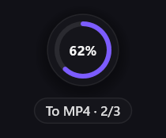
  
  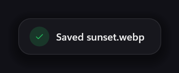
</p>

Every job shows an animated progress ring where you clicked, ending in a check mark, and the new file is saved next to the original (never overwritten).

## Sharing

**Share** opens a window with a QR code and a link:

- **Phone or PC on the same Wi-Fi:** scan the QR code or open the link in any browser. Nothing to install.
- **Other networks:** click **Make internet link** to get a public link through a free Cloudflare tunnel (the 55 MB tool downloads on first use).
- **Send back:** the share page has a **Send to PC** button. Files land in your Downloads folder.

**Receive** (empty-space menu, or *Receive files from phone…* in the tray) shows a QR code that lets a phone upload files straight into that folder.

Links contain a random code, stop working when you close the window, and expire after 10 minutes. The first time, Windows Firewall asks for permission: allow **Private networks**.

## Requirements

- Windows 10 or 11 (64-bit)
- Tools that download automatically on first use into `%LOCALAPPDATA%\Orbit\tools`:

| Tool | Used for | Size |
|---|---|---|
| FFmpeg | Images, audio, video (skipped if already on PATH) | ~200 MB |
| 7-Zip (`7zr.exe`) | 7z archives | 0.6 MB |
| LibreOffice | Documents, only if Microsoft Office isn't installed | ~375 MB |
| cloudflared | Internet share links | 55 MB |

RAR creation uses WinRAR when installed; otherwise Orbit makes a ZIP.

## Privacy

Orbit has no accounts, telemetry or cloud. Files never leave your PC unless you share them. Sharing runs a small web server on your own computer. The only outside connections are the one-time tool downloads above and the Cloudflare tunnel, and only when you click *Make internet link*.

## Build from source

Requires [Rust](https://rustup.rs) with the MSVC toolchain (Visual Studio Build Tools).

```sh
cargo build --release
# output: target/release/orbit.exe
```

Developer flags:

| Flag | Purpose |
|---|---|
| `--screenshots <dir>` | Render the README screenshots (no windows shown) |
| `--demo <paths…> [--bg]` | Open the menu for given files (or a folder's empty space) |
| `--probe X Y` | Write what Orbit detects at a screen point to `%TEMP%\orbit_probe.txt` |

Troubleshooting: set `ORBIT_LOG=1` before launching and read `%TEMP%\orbit.log`.

## Project layout

| File | Role |
|---|---|
| `src/main.rs` | Tray, hotkey, mouse hook, startup |
| `src/radial.rs` | The radial menu (drawing, animation, input) |
| `src/menu.rs` | Which options appear for which selection |
| `src/actions.rs` | Every action |
| `src/explorer.rs` | Reading the Explorer selection (Shell COM + UI Automation) |
| `src/share.rs` | QR share/receive window and local web server |
| `src/hud.rs` | Progress rings and toasts |
| `src/gfx.rs` | Direct2D/DirectWrite on layered windows |
| `src/tools.rs` | Finding/downloading FFmpeg, 7-Zip, LibreOffice, cloudflared |
| `src/pdf.rs`, `src/exif.rs`, `src/fileops.rs` | PDF tools, EXIF reader, shell file operations |

## License

[MIT](LICENSE)
